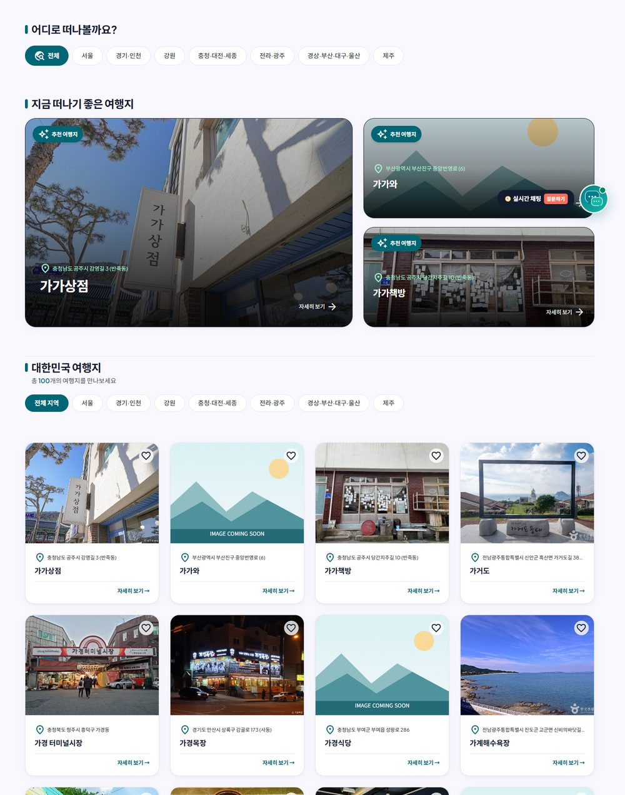
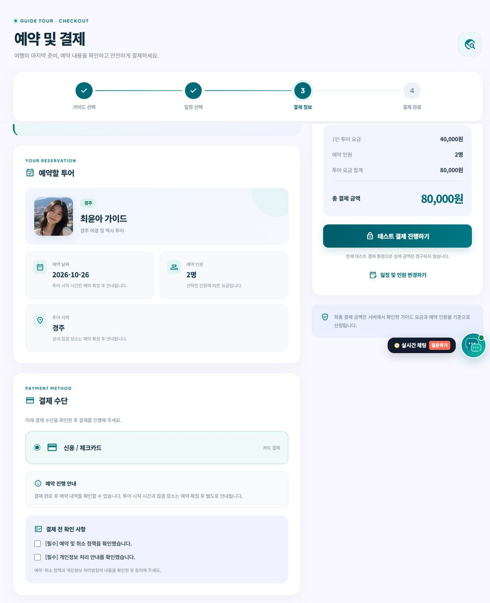

# 놀러가자 | 국내 여행지 탐색과 가이드 예약

국내 여행지를 지역과 키워드로 찾아보고, 가이드를 선택해 날짜와 인원을 정한 뒤 테스트 결제를 진행하는 웹 서비스입니다.

**배수환 · 부팀장**

2026.09.21 ~ 2026.10.25 · KH정보교육원 세미 프로젝트 · 4인 팀

여행지 조회와 가이드 예약·결제, 한·영·일 번역, 회원 실시간 채팅을 담당했습니다. 가이드 예약에서는 **같은 날짜의 중복 주문**을 DB 제약으로 처리하고, 테스트 결제에서는 **금액 검증과 중복 승인 방지**를 서버에 구현했습니다.

## 담당 기능과 코드

| 담당 기능 | 구현 내용 | 관련 코드 |
| --- | --- | --- |
| **여행지 조회** | 한국관광공사 TourAPI의 지역별 목록·키워드 검색·상세 정보를 Servlet을 통해 조회했습니다. JavaScript `fetch()`로 목록과 상세 화면을 갱신하고, 같은 요청의 정상 응답은 서버 메모리에 저장해 재사용했습니다. | [Servlet](src/main/java/controller/TravelDestinationController.java) · [TourAPI 서비스](src/main/java/service/TravelDestinationService.java) |
| **가이드 예약** | JDBC로 가이드를 조회하고, 선택한 날짜와 인원을 검증해 결제에 사용할 예약 정보를 세션에 보관했습니다. | [예약 Servlet](src/main/java/controller/GuideReservationController.java) · [가이드 조회 DAO](src/main/java/dao/GuideReservationDao.java) |
| **Toss Payments 테스트 결제** | 서버에서 가이드 요금과 인원으로 주문 금액을 계산하고, 토스 인증 후 돌아온 주문과 금액을 검증했습니다. 주문 상태를 먼저 바꾼 요청만 승인 API를 호출하도록 했습니다. | [주문 생성](src/main/java/controller/PaymentInfoController.java) · [결제 승인 처리](src/main/java/controller/TossPaymentSuccessController.java) · [주문 DAO](src/main/java/dao/TossTestOrderDao.java) |
| **한·영·일 번역** | 화면의 텍스트를 `/translate`로 보내 Google Translate API와 연동했습니다. 한국어 원문을 보관해 언어를 바꿀 때 원문으로 다시 요청하고, 동적으로 추가된 텍스트도 감지하도록 했습니다. | [번역 JavaScript](src/main/webapp/resources/js/translate/translate.js) · [번역 서비스](src/main/java/service/TranslateService.java) |
| **회원 실시간 채팅** | WebSocket 연결에서 로그인 세션을 확인했습니다. 메시지를 DB에 저장한 뒤 접속 중인 회원에게 전달하고, 새로 접속하면 최근 메시지 30개를 불러오도록 했습니다. | [WebSocket 엔드포인트](src/main/java/websocket/MemberChatWebSocket.java) · [채팅 DAO](src/main/java/dao/MemberChatDao.java) |

## 예약·결제에서 처리한 세 가지 문제

### 1. 결제 화면의 금액 변경

서버가 DB에서 가이드의 1인 요금을 읽고 `요금 × 인원`을 계산해 `PENDING` 주문에 저장했습니다. 토스 결제 인증 후에는 현재 세션의 주문 번호인지 확인하고, 전달받은 금액이 DB에 저장된 주문 금액과 일치할 때 승인 단계로 넘어갑니다. [주문 생성 코드](src/main/java/controller/PaymentInfoController.java) · [금액과 세션 검증 코드](src/main/java/controller/TossPaymentSuccessController.java)

### 2. 같은 가이드·같은 날짜의 이중 예약

두 요청이 동시에 예약 가능 여부를 조회하면 모두 예약 가능하다고 판단할 수 있습니다. 예약 자리를 점유하는 주문에 날짜를 부여하는 생성 컬럼 `booking_date_key`와 `UNIQUE(guide_id, booking_date_key)` 조합으로 저장 시점의 충돌을 처리하도록 설계했습니다. Servlet은 `uk_guide_booking` 제약의 중복 오류를 `409 Conflict`로 변환합니다. [팀 ERD](docs/images/erd.png) · [충돌 응답 코드](src/main/java/controller/PaymentInfoController.java)

### 3. 동일 주문의 반복 승인 요청

결제 인증 성공 화면을 새로고침하거나 같은 요청이 겹칠 때, `WHERE order_id = ? AND status = 'PENDING'` 조건에 맞는 주문만 `CONFIRMING`으로 바꿉니다. 변경된 행이 1개인 요청이 토스 승인 API를 호출합니다. 승인 결과를 저장하면 `PAID`가 되고, 결과 확인이 필요한 예외는 `REVIEW`로 기록합니다. [상태 변경 코드](src/main/java/dao/TossTestOrderDao.java) · [승인 처리 코드](src/main/java/controller/TossPaymentSuccessController.java)

## 여행지 조회에서 TourAPI 호출 줄이기

동일한 요청 URL에 대한 성공 응답을 메모리에 저장했습니다. 같은 조건으로 다시 조회하면 유효기간 안에 저장된 응답을 반환합니다. 목록·상세는 **1시간**, 키워드 검색은 **10분** 동안 보관합니다. `LinkedHashMap`을 접근 순서로 관리해 **최대 200개**를 넘으면 가장 오래 사용하지 않은 항목부터 제거합니다. [캐시 처리 코드](src/main/java/service/TravelDestinationService.java)

## 담당 기능 화면

| 여행지 목록·지역 필터 | 가이드 예약·결제 금액 확인 |
| --- | --- |
|  |  |

### 토스페이먼츠 테스트 결제

예약 정보에서 **테스트 결제 진행하기**를 누르면 SDK가 카드 결제창을 요청합니다. 결제 인증 후 서버가 주문과 금액을 확인하고 토스페이먼츠 승인 API를 호출합니다. [결제창 호출 코드](src/main/webapp/WEB-INF/paymentInfo/paymentInfo.jsp#L92-L154) · [서버 승인 코드](src/main/java/controller/TossPaymentSuccessController.java)

**카드·간편결제 통합결제창 예시 · 토스페이먼츠 개발자센터**

[가이드 목록](docs/images/guide.jpg) · [영어 번역 적용 화면](docs/images/translate.jpg) · [회원 실시간 채팅 화면](docs/images/live_chat.jpg)

## 팀 구성과 실행 환경

**사용 기술** · Java 21, Servlet/JSP Model 2 MVC, JSTL, JavaScript, JDBC, MySQL 8, WebSocket

**팀 시연 환경** · AWS Lightsail에서 Nginx가 HTTPS 요청을 받고, Apache Tomcat 9에 배포된 WAR가 요청을 처리했습니다. 애플리케이션은 JNDI DataSource를 통해 MySQL에 연결합니다.

| 팀원 | 담당 영역 |
| --- | --- |
| 권성애 · 팀장 | 숙박, AI 여행 일정, 관리자, 팀 배포 |
| **배수환 · 부팀장** | **여행지, 가이드 예약·결제, 번역, 실시간 채팅** |
| 이재준 | 음식, Q&A, 마이페이지 |
| 한상희 | 문화유산, 메인, 회원, 리뷰 |

로컬 실행에 필요한 준비

1. JDK 21, Eclipse의 Dynamic Web Project 환경, Apache Tomcat 9, MySQL 8을 준비합니다.
2. `travel` DB에 프로젝트의 테이블과 시연 데이터가 필요합니다. 저장소에는 [ERD](docs/images/erd.png)가 포함되어 있으며, 실행용 SQL 덤프는 별도로 확보해야 합니다.
3. [context.xml.example](src/main/webapp/META-INF/context.xml.example)을 같은 폴더의 `context.xml`로 복사한 뒤 로컬 DB 연결 정보를 설정합니다. 애플리케이션은 `jdbc/travel` 리소스를 조회합니다.
4. 클래스패스 루트에 `config.properties`를 만들고 사용하는 기능의 키를 설정합니다. 여행지 조회는 `tour.api.js.key`, 번역은 `google.api.key`, 결제는 `toss.client.key`와 `toss.secret.key`를 사용합니다. 결제에는 테스트 키를 사용합니다.
5. Tomcat에 컨텍스트 경로를 `/travel`로 설정해 실행한 뒤 `http://localhost:8080/travel/Main`으로 접속합니다.

## 보완할 점

- 같은 날짜의 동시 주문과 반복 결제 인증 요청에서 DB 상태와 응답을 함께 검증하는 통합 테스트를 추가합니다.
- 결제를 중단한 대기 주문의 자동 만료와 `REVIEW` 주문의 결제 상태 확인 절차를 마련합니다.
- 공개 체크아웃에서도 재현할 수 있도록 시연용 스키마와 테스트 데이터를 준비합니다.
